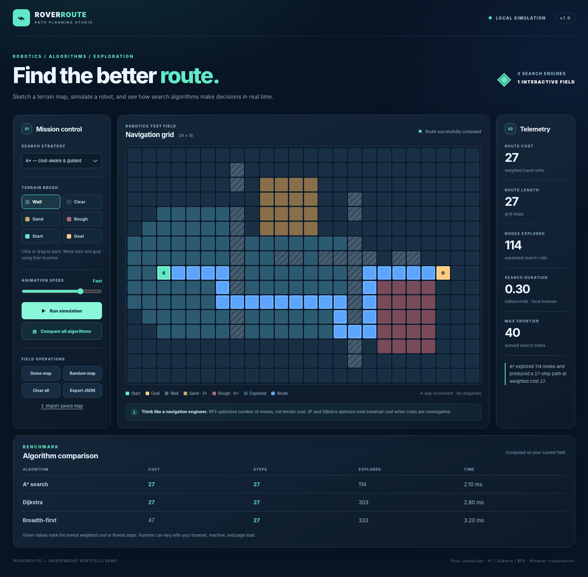

# RoverRoute — Robot Path Planning Studio



An interactive, browser-based robotics navigation sandbox comparing **A\***, **Dijkstra**, and **breadth-first search** on editable weighted terrain.

## Features
- Paint walls (impassable), sand (cost 3), and rough terrain (cost 6); drag the start and goal positions using the corresponding brushes.
- Animated visualization of explored nodes and the selected final path.
- On-demand side-by-side benchmark for weighted route cost, number of steps, nodes expanded, runtime, and peak frontier size.
- Generate deterministic solvable random fields, reset to a demo, clear the map, and import/export maps as JSON.
- Fully local, responsive UI with keyboard-accessible grid cells.
- Testable pure search algorithms, including a binary-heap priority queue.

## Run locally
Requires Python 3 for a simple local static-file server. No pip or npm dependencies.

```bash
cd RoverRoute
python3 -m http.server 8000
```
Open **http://localhost:8000** in a browser. If the port is busy, use another port.

> Opening `index.html` directly from Finder may block JavaScript module imports. Use the local server command above.

## Run tests
Requires Node.js 18+ (`node --test`):

```bash
node --test tests/pathfinding.test.mjs
```

The tests cover shortest-path behavior, non-uniform terrain weights, unreachable endpoints, zero-length routes, validation, and consistency of A* vs. Dijkstra over 60 seeded randomized weighted maps.

## Algorithms
- **BFS:** FIFO queue; shortest path in *number of moves*. Does not account for sand/rough costs.
- **Dijkstra:** min-priority queue; minimum *sum of entering-cell costs*.
- **A\*:** Dijkstra plus Manhattan heuristic. Since all traversable terrain costs >= 1 and movements are 4-connected, the heuristic is admissible and consistent. Returns minimum-cost routes.

Movement is 4-connected (up/down/left/right), no corner cutting, and the start cell costs zero. Search duration is wall-clock time for the search function, not animation duration, and varies by device.

## Suggested demo
1. Run A* on the supplied map and watch the explored cells.
2. Compare all three algorithms; note weighted route cost versus raw step count.
3. Paint a rough-terrain shortcut between the endpoints and see BFS favor fewer steps while A* avoids expensive cells.
4. Export the map and import it again.

## Architecture
```text
RoverRoute/
├── index.html            # Semantic UI and controls
├── styles.css            # Responsive visual system
├── app.js                # Editor, animation, accessibility, metrics
├── pathfinding.mjs       # Pure algorithms / priority queue / grid generators
└── tests/
    └── pathfinding.test.mjs
```

## Limitations and follow-on ideas
This is a **2D planning simulation**, not a ROS 2 controller or a claim that it was run on a physical robot. For more technical depth, add an obstacle sensor emulator, live replanning on obstacle changes, an occupancy grid imported from an image, or a ROS 2 bridge (separate project).

## Resume description — after you run it and understand it
**RoverRoute | JavaScript, A*, Dijkstra, BFS**
- Built an interactive weighted-grid robot navigation studio comparing three pathfinding algorithms and visualizing expanded nodes and final routes.
- Implemented a binary-heap priority queue, terrain-aware traversal costs, randomized test maps, JSON import/export, and automated correctness tests.

*Independent personal project; do not label it an IEEE team deliverable unless it was actually part of your team's work.*
